# Unsung Vale

An original third-person fantasy RPG that runs in the browser on three.js.

A valley of sheer mesas, waterfalls and white-and-gold spires has fallen silent. You play
the Cantor, a masked wanderer-knight who crosses it at golden hour, breaks the constructs
that guard its eight Tuning Spires, and wakes each one so colour, sound and the people of the
Vale return. The first three stand in the inner valley, a walk apart. The other five lie on
the mesas round the lake and are reached by riding strings of light. A full journey with its
side quests and trials takes about two hours.

Everything you see is generated by code in this repository: the terrain, the rock and
stone textures, every tree, flower, building and enemy. No models or image textures were
imported. The hero is produced by a Blender Python script. Only the music and sound effects
come from outside; they are credited in [CREDITS.md](CREDITS.md).

| | |
| --- | --- |
| 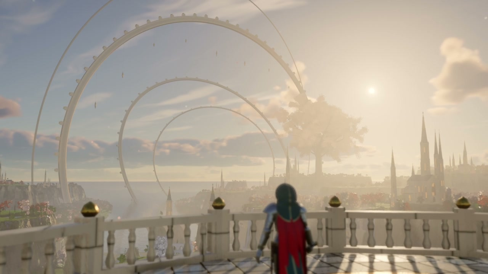 | 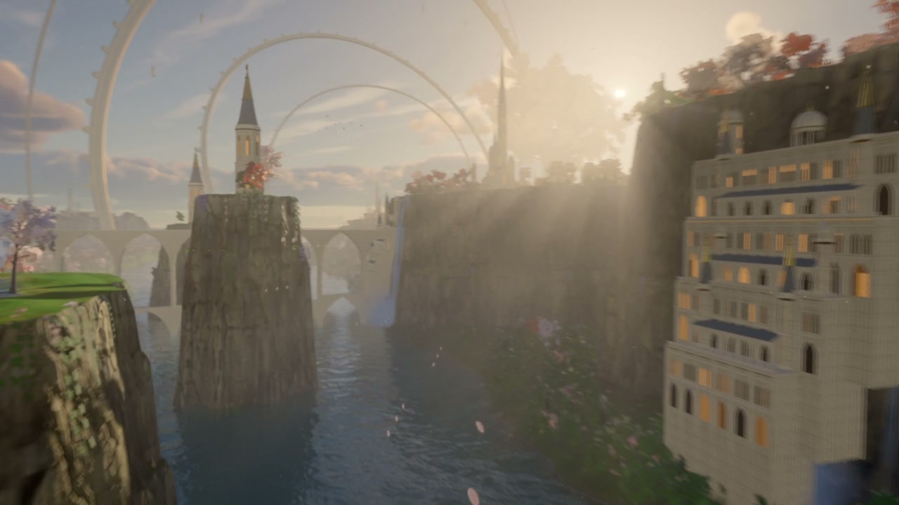 |
| 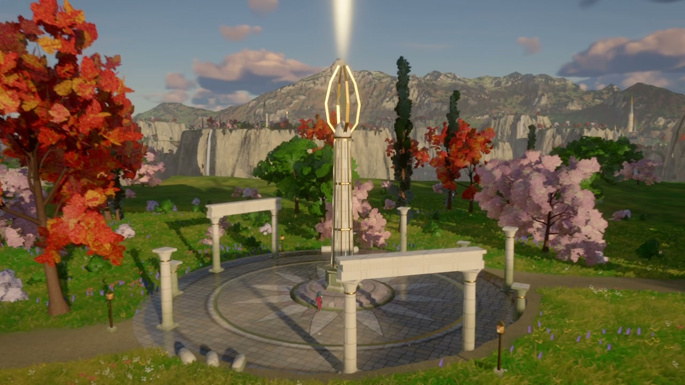 | 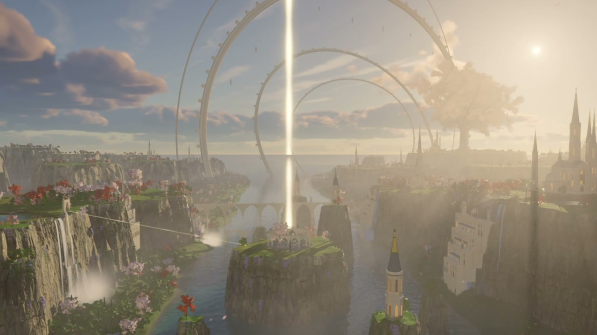 |

Stills from the in-game cinematic (draft render).

| | |
| --- | --- |
| 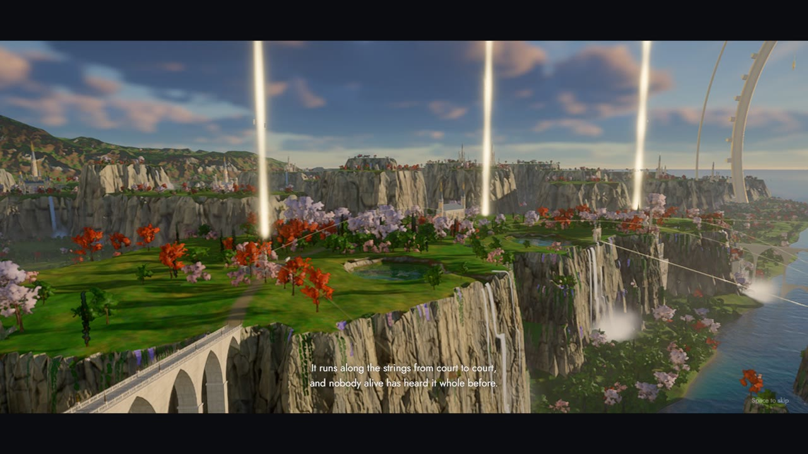 | 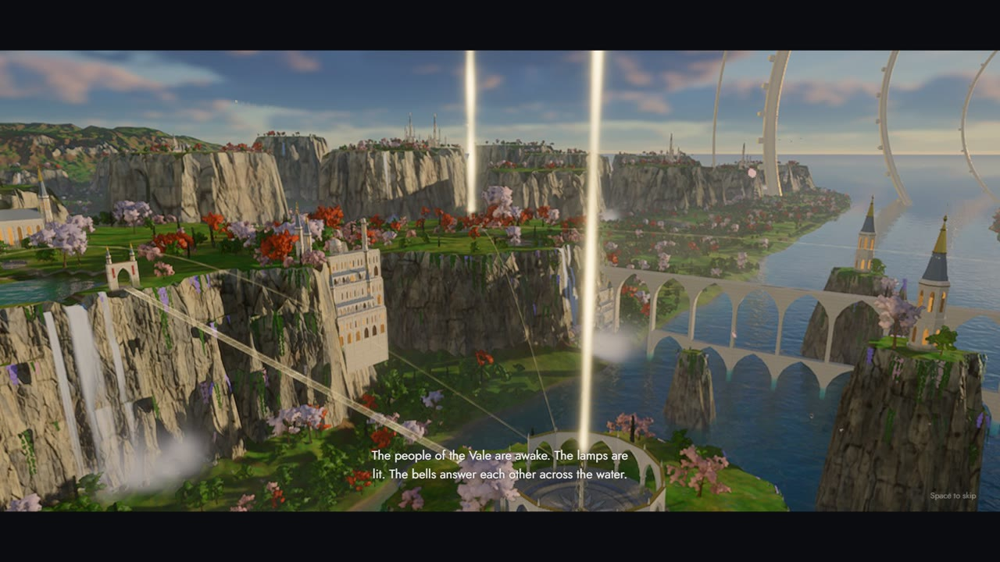 |
| 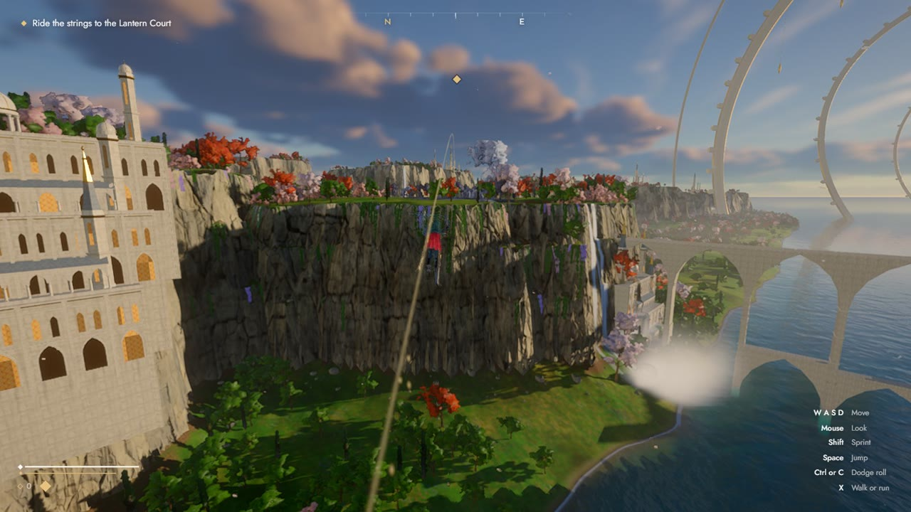 | 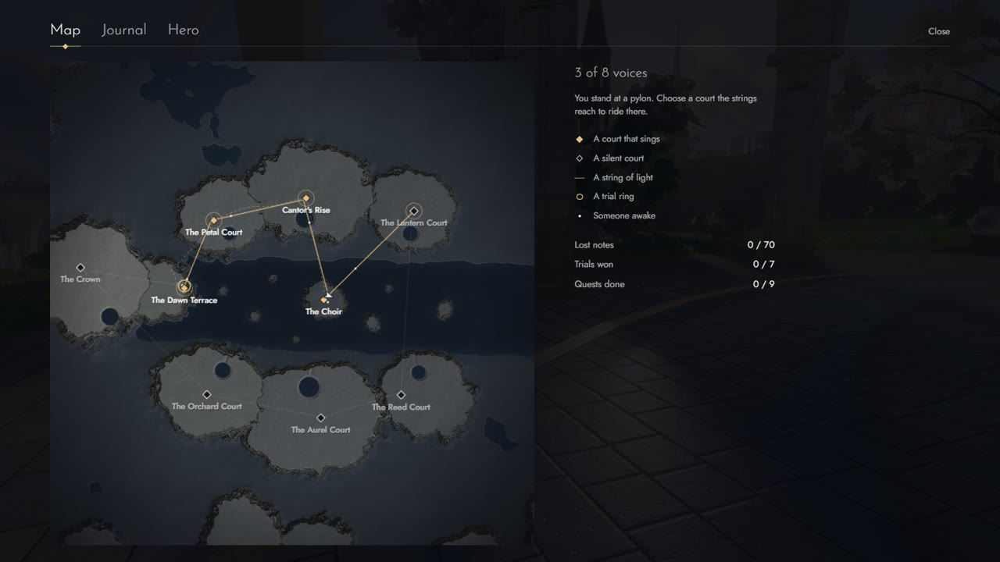 |
| 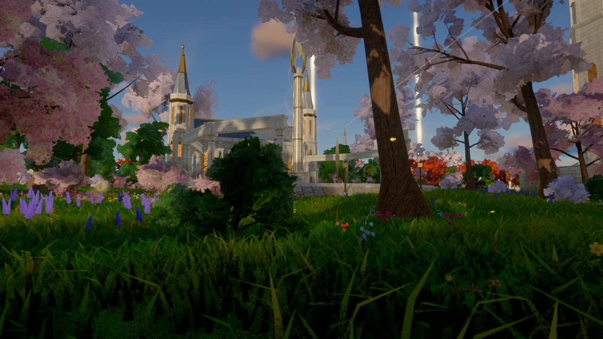 | 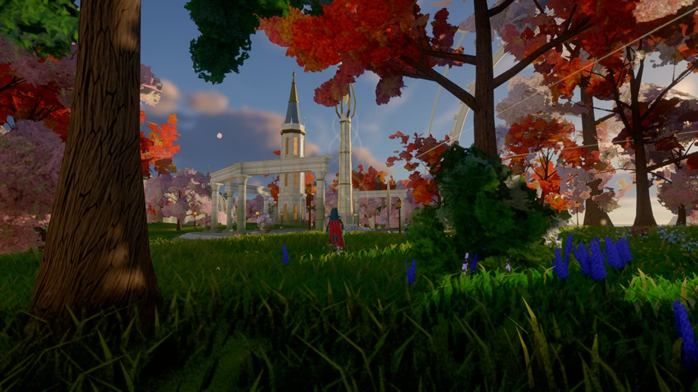 |
| 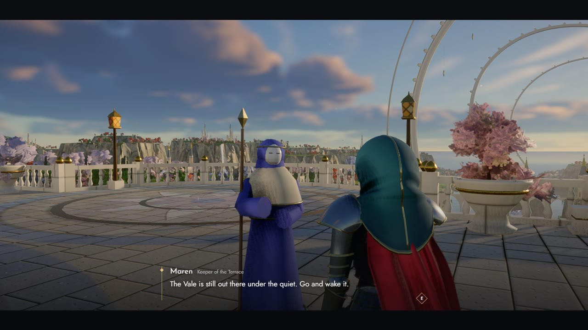 | 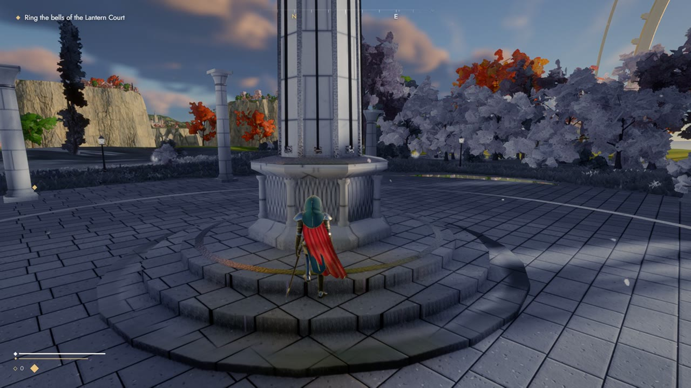 |
| 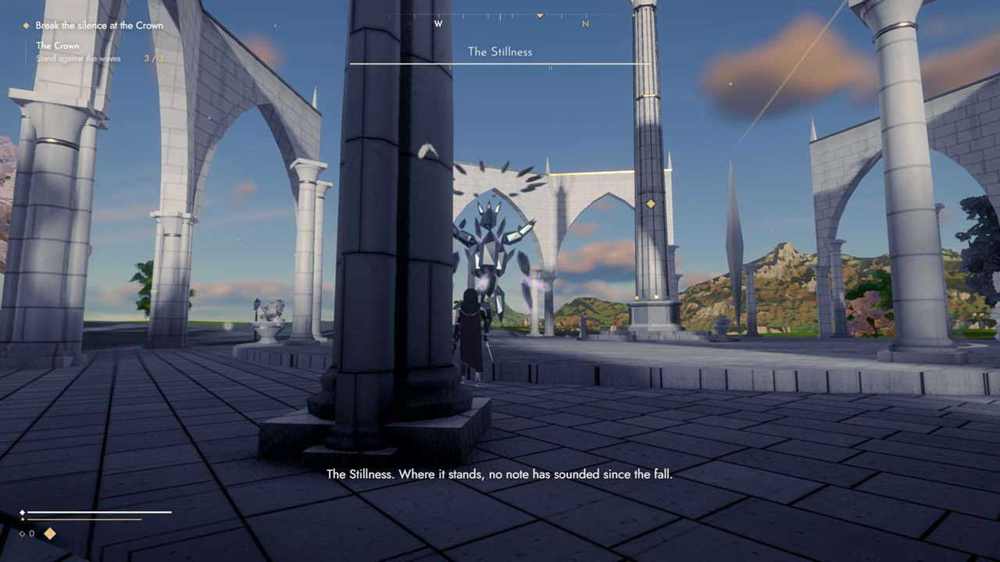 | 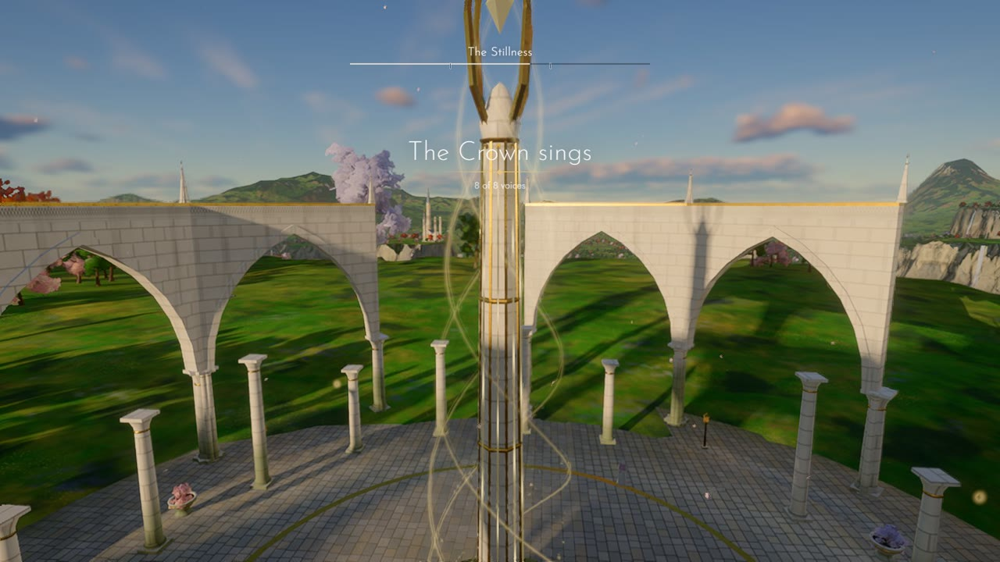 |

Play, as captured by `tools/tour.mjs`.

## Run it

```bash
npm install
npm run dev
```

Then open http://localhost:5183. A recent Chrome or Edge with WebGL 2 is needed. The first
load takes a little while because the world is baked on your GPU.

## Controls

| Action | Keyboard and mouse | Gamepad |
| --- | --- | --- |
| Move / look | W A S D / mouse | Left stick / right stick |
| Sprint | Shift | Left stick click or left trigger |
| Walk or run | X | Tilt the stick |
| Jump | Space | A |
| Dodge roll | Ctrl or C | B |
| Strike (three-step combo) | Left mouse | X or right bumper |
| Heavy strike | Right mouse | Y or right trigger |
| Falling strike | Strike while in the air | Same |
| Resonance pulse (once learned) | F | Left bumper |
| The refrain (mends you; a few to a journey) | R | D-pad up |
| Lock on | Q | Right stick click |
| Speak, tune a spire, ride a string, open a reliquary | E | D-pad down or left |
| Map / journal | M / J | Back / D-pad right |
| Zoom the camera | Mouse wheel | |
| Photo mode (free camera; click saves a PNG) | H | |
| Pause | Esc | Start |

A spire is tuned by striking its notes: rings of light close on the shaft one after another,
and E (or the sword) is pressed as each one meets it.

Graphics quality, the frame rate to hold, render scale, floor reflections, field of view,
sensitivity and volumes are in Settings. The mouse is read as raw movement, so the view
turns exactly as far as the hand moves, whatever the system's pointer settings.

## What is in the demo

- A 2 km playable core inside a 16 km region, with detail carried to the horizon:
  far cities, cliff-side quarters, viaducts, waterfalls, forests, the Lattice rings and the
  Elder tree.
- Cliffs of jointed, faceted rock whose relief shadows itself, hung with vines and wisteria
  along their rims; karst pillars in the lake; talus, shrubs, flowers, butterflies, falling
  petals and sunlit dust up close; flocks of birds turning over the spires and the pools.
- Trees whose crowns shade as billowed masses and whose leaves each catch the light and
  glow when the sun is behind them; meadows that stay varied from your feet to the far mesas.
- Physically based sky and volumetric clouds with the sun breaking through a gap, light
  shafts through valley mist, baked terrain shadows, soft cascaded shadows that sharpen at
  the caster's foot, warm light bounced into the shade, lantern light, screen-space
  reflections on the water and in the polished, inlaid floors of the courts.
- Eight courts to restore. The inner three (the Petal Court, Cantor's Rise, the Choir) are
  linked by paths, a long stair and a bridge of light. Each of the outer five first has its
  three bells rung, out on its mesa and under guard, and is then fought for in waves led by
  a named elite. The Crown ends with a boss in three phases.
- Strings of light between the courts: hook the blade over one and ride it across the lake.
  From any pylon the map can send you along several strings to a court already restored.
- Eight kinds of construct (thrall, lancer, hound, shield-bearing warden, spell-casting
  chorister, brute, seeker, colossus), tougher veterans and elites of each, and packs that
  roam the mesas. They work together: a chorister throws a ward of light over one of its
  own until the singer is broken, a brute that cannot reach you rushes along a line marked
  on the ground, seekers fly at you and burst, thralls cut twice.
- A fight with some depth to it: a bolt met with the blade goes back at whoever is nearest,
  a heavy blow on a staggered construct rings it like a bell, and blows landed without one
  taken build cadence in four steps, each putting more weight in the blade, until every cut
  rings. One hit taken and it is lost. Wounds are mended with the refrain, a note the hero
  hums: a few to a journey, given back at spires, bells, pylons and with lost notes.
- The people of the Vale: masked, robed figures who stand as grey statues until their spire
  is tuned, then wake and ask for something. Nine side quests, seven trials (wave rings and
  timed runs through gates of light), seventy lost notes.
- Growth: each spire teaches an ability (resonance pulse, running cut, echo step, and more),
  and gifts and the luthier's bench raise life, breath and the blade's edge.
- Reliquaries: a stone casket on every mesa, off the paths and under guard, each holding a
  charm. Two are worn at a time (three once five spires sing), chosen on the Hero screen:
  a stronger refrain, faster breath, longer cadence, guard-breaking heavy blows, mending on
  a slipped blow, thorns, more resonance, bolts that burst when struck back.
- Swimming, a sword that is sheathed when there is nothing to fight, a falling strike with
  a somersault and a shockwave, being thrown off your feet by heavy blows.
- A short opening and a light thread of story: a few lines at the stations of the journey,
  goals that lead from one landmark to the next, and lost notes of the old song along the
  paths that play a rising scale as they are gathered.
- A hero animated entirely in code: feet placed on the ground by inverse kinematics, a
  sword led along designed cuts with the body following, a cape on springs.
- A solid world: trees, boulders and the constructs all stop you, and the camera with you.
- Effects built for the moments that matter: a crescent of light behind every cut, sparks
  off every blow, shockwaves that bend the picture, strands of light climbing a spire as it
  is tuned, the great rings answering.
- A closing flight over the whole Vale once the last spire sings.
- An interface drawn around one idea, a string: a compass strip, goals and a side-quest
  tracker, conversations, a map drawn from the terrain itself, a journal, settings.
  Progress is saved in the browser.

## How it is made

[docs/ARCHITECTURE.md](docs/ARCHITECTURE.md) walks through the engine, the world generators
and the game code. Useful commands:

```bash
npm run world                      # re-bake the terrain height maps after editing the layout
node tools/capture.mjs --help      # see the header of the file for the film render options
```

The hero model is rebuilt with Blender 5.x:

```bash
blender --background --python tools/blender/hero.py
```

### Rendering the cinematic

Build the game, serve the build, and render the film in resumable five-second parts:

```bash
npm run build
npm run preview
node tools/render-film.mjs --w 3840 --h 2160 --fps 60 --out renders/unsung-vale
```

This plays the in-game cinematic at a fixed time step, renders every frame offline with
motion blur and depth of field, and writes an HDR10 master (HEVC Main10, PQ, BT.2020) and an
SDR companion (H.264). It needs `ffmpeg` on the PATH and Chrome or Edge installed.

On Windows, `powershell -File tools/start-render.ps1` starts the same render detached from the
shell, so it survives a closed terminal; it is resumable either way.

Captures run in a film detail mode that would be too heavy for play: full-detail trees and
grass several times further out, sharper shadows and foliage textures. To look at it without
rendering, open the game with `?film=1` added to the address.

## Performance

The demo was developed on an integrated GPU (AMD Radeon 780M). The default Medium preset
renders at two thirds resolution with temporal anti-aliasing; discrete GPUs start on High.
Every preset holds a frame rate of your choosing (50 by default) by lowering the internal
render resolution when it has to, never the detail: on that integrated GPU, Ultra at 1080p
settles at about three quarters of full resolution. Set "Frame rate to hold" to Off to
render at the preset's full resolution regardless.

## Licence

Code is released under the MIT licence (see [LICENSE](LICENSE)). The audio files in
`public/audio` belong to their authors and are used under the licences listed in
[CREDITS.md](CREDITS.md).
