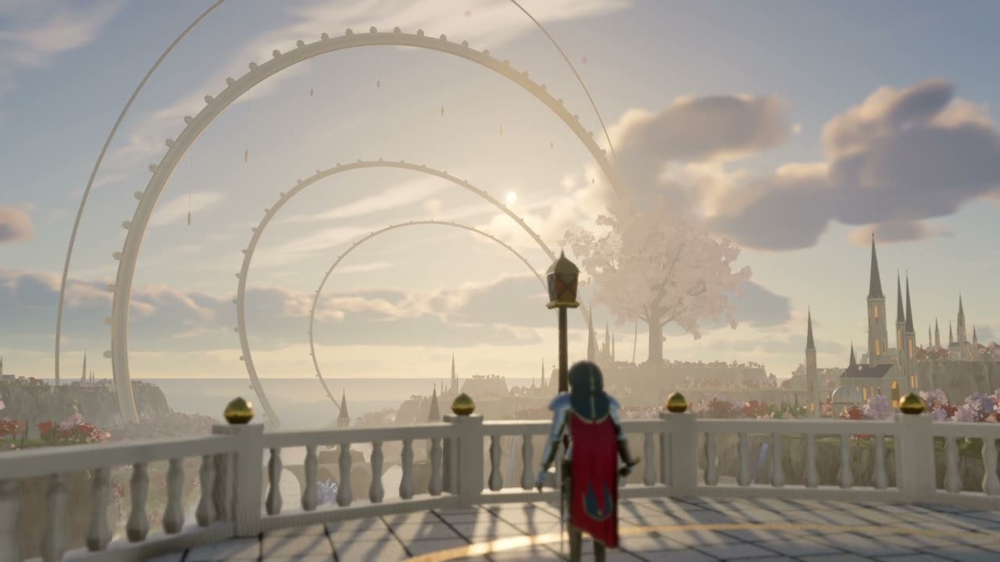
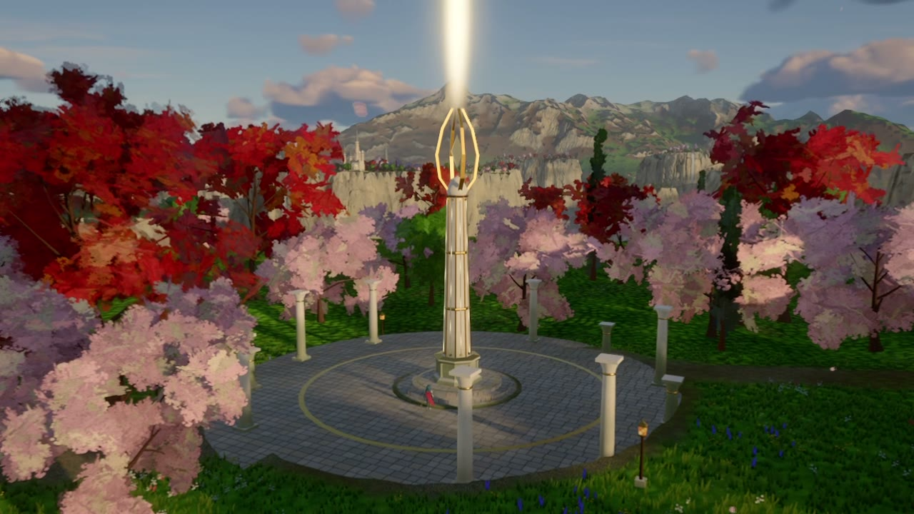
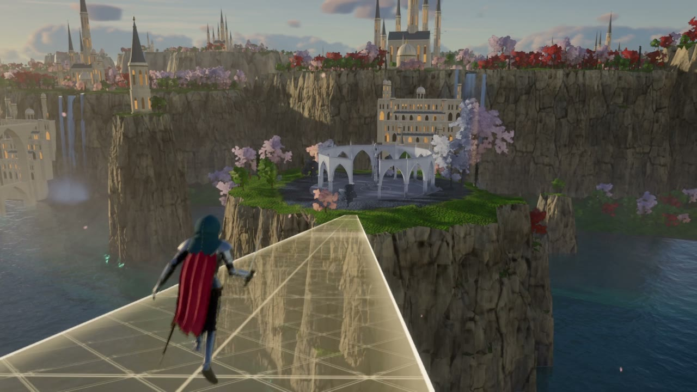
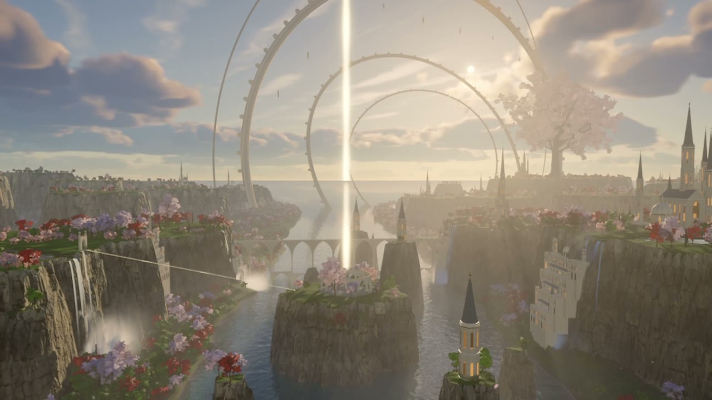

# Unsung Vale

An original third-person fantasy RPG demo that runs in the browser on three.js.

A valley of sheer mesas, waterfalls and white-and-gold spires has fallen silent. You play
the Cantor, a masked wanderer-knight who crosses it at golden hour, breaks the constructs
that guard its three Tuning Spires, and wakes each one so colour and sound return.

Everything you see is generated by code in this repository: the terrain, the rock and
stone textures, every tree, flower, building and enemy. No models or image textures were
imported. The hero is produced by a Blender Python script. Only the music and sound effects
come from outside; they are credited in [CREDITS.md](CREDITS.md).

| | |
| --- | --- |
|  |  |
|  |  |

Stills from the in-game cinematic (draft render).

## Run it

```bash
npm install
npm run dev
```

Then open http://localhost:5183. A recent Chrome or Edge with WebGL 2 is needed. The first
load takes a little while because the world is baked on your GPU.

## Controls

| Action | Keyboard and mouse | Gamepad |
| --- | --- | --- |
| Move / look | W A S D / mouse | Left stick / right stick |
| Sprint | Shift | Left stick click or left trigger |
| Jump | Space | A |
| Dodge roll | Ctrl or C | B |
| Strike (three-step combo) | Left mouse | X or right bumper |
| Heavy strike | Right mouse | Y or right trigger |
| Resonance pulse | F | Left bumper |
| Lock on | Q | Right stick click |
| Tune a spire | Hold E | D-pad |
| Pause | Esc | Start |

Graphics quality, render scale, floor reflections, field of view, sensitivity and volumes
are in Settings.

## What is in the demo

- A 2 km playable core inside a 16 km region, with detail carried to the horizon:
  far cities, cliff-side quarters, viaducts, waterfalls, forests, the Lattice rings and the
  Elder tree.
- Cliffs of jointed, faceted rock whose relief shadows itself, hung with vines and wisteria
  along their rims; karst pillars in the lake; talus, shrubs, flowers, butterflies, falling
  petals and sunlit dust up close.
- Trees whose crowns shade as billowed masses and whose leaves each catch the light and
  glow when the sun is behind them; meadows that stay varied from your feet to the far mesas.
- Physically based sky and volumetric clouds with the sun breaking through a gap, light
  shafts through valley mist, baked terrain shadows, soft cascaded shadows that sharpen at
  the caster's foot, warm light bounced into the shade, lantern light, screen-space
  reflections on the water and in the polished, inlaid floors of the courts.
- Three sites to restore (the Petal Court, Cantor's Rise, the Choir), three kinds of enemy
  including a boss, a light bridge that forms once the second spire is tuned.
- A title screen, HUD, pause menu and settings; progress is saved in the browser.

## How it is made

[docs/ARCHITECTURE.md](docs/ARCHITECTURE.md) walks through the engine, the world generators
and the game code. Useful commands:

```bash
npm run world                      # re-bake the terrain height maps after editing the layout
node tools/capture.mjs --help      # see the header of the file for the film render options
```

The hero model is rebuilt with Blender 5.x:

```bash
blender --background --python tools/blender/hero.py
```

### Rendering the cinematic

Build the game, serve the build, and render the film in resumable five-second parts:

```bash
npm run build
npm run preview
node tools/render-film.mjs --w 3840 --h 2160 --fps 60 --out renders/unsung-vale
```

This plays the in-game cinematic at a fixed time step, renders every frame offline with
motion blur and depth of field, and writes an HDR10 master (HEVC Main10, PQ, BT.2020) and an
SDR companion (H.264). It needs `ffmpeg` on the PATH and Chrome or Edge installed.

On Windows, `powershell -File tools/start-render.ps1` starts the same render detached from the
shell, so it survives a closed terminal; it is resumable either way.

Captures run in a film detail mode that would be too heavy for play: full-detail trees and
grass several times further out, sharper shadows and foliage textures. To look at it without
rendering, open the game with `?film=1` added to the address.

## Performance

The demo was developed on an integrated GPU (AMD Radeon 780M). The default Medium preset
renders at two thirds resolution with temporal anti-aliasing; discrete GPUs start on High.

## Licence

Code is released under the MIT licence (see [LICENSE](LICENSE)). The audio files in
`public/audio` belong to their authors and are used under the licences listed in
[CREDITS.md](CREDITS.md).
